# Herculito

Fue mi segundo robot, pero el primero que tuve que editar y soldar bastante
para dejarlo funcionando.

Robot de Microsumo (5×5×5 cm, < 100 g) de 2019. El nombre lo eligió Esdrufao:
*"por lo robusto que se ve, lo llamaría Herculito"*.

- Chasis: diseño de Mario V.C.
- Placa: diseño de Esdrufao (microsumo de 2019), basado en su robot [Centeno](https://github.com/hunter-digi-ace/Centeno)
- Sensores: 6× TCRT5000 soldados a mano (3 de suelo + 3 de enemigo)
- Tracción: 2 servos modificados (motor + reductora), pegados en L

<p align="center">
  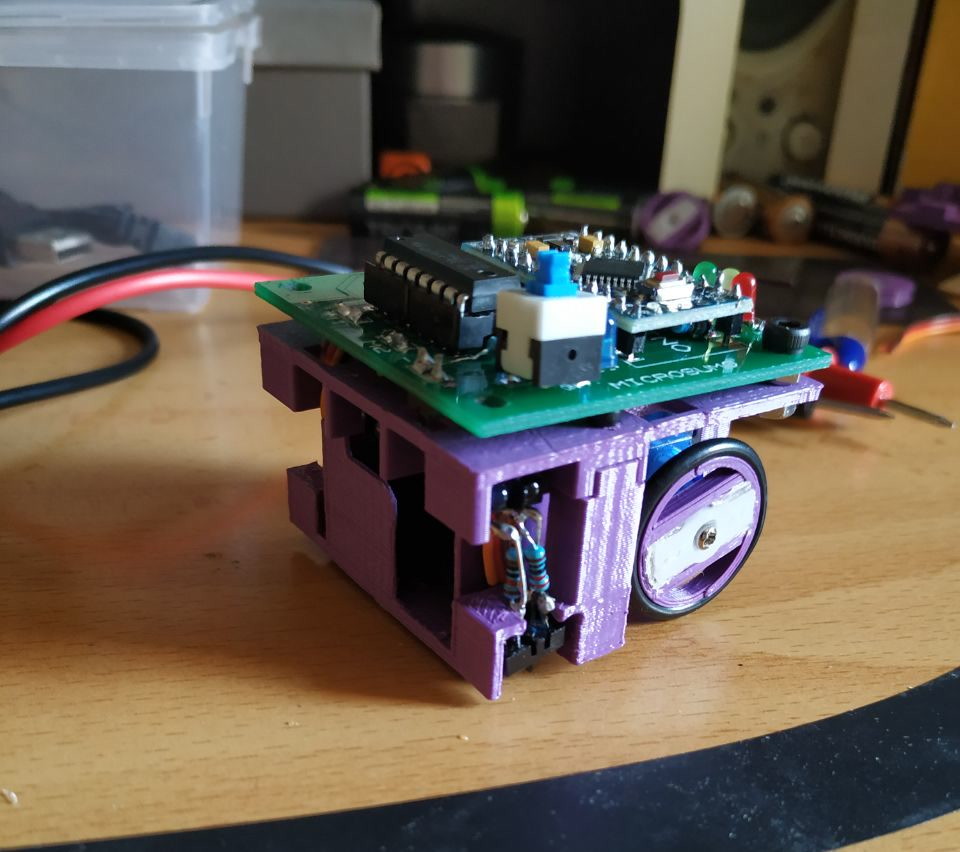
  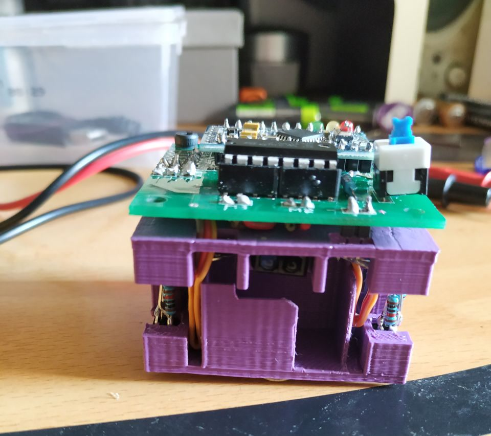
  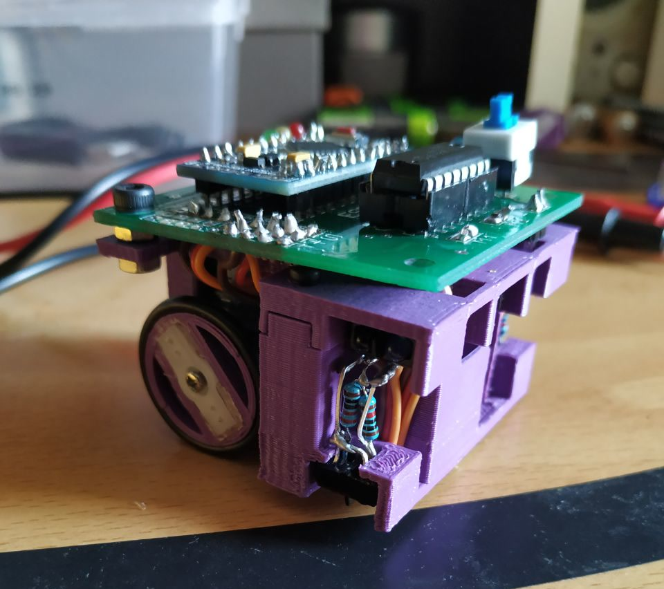
</p>
<p align="center">
  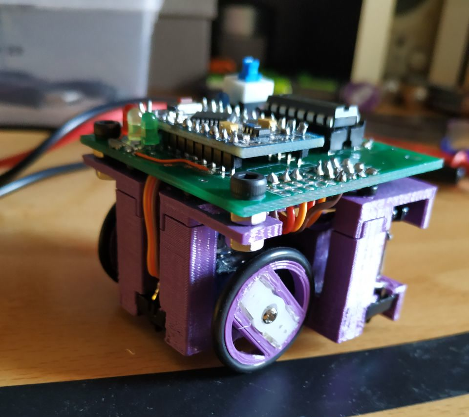
  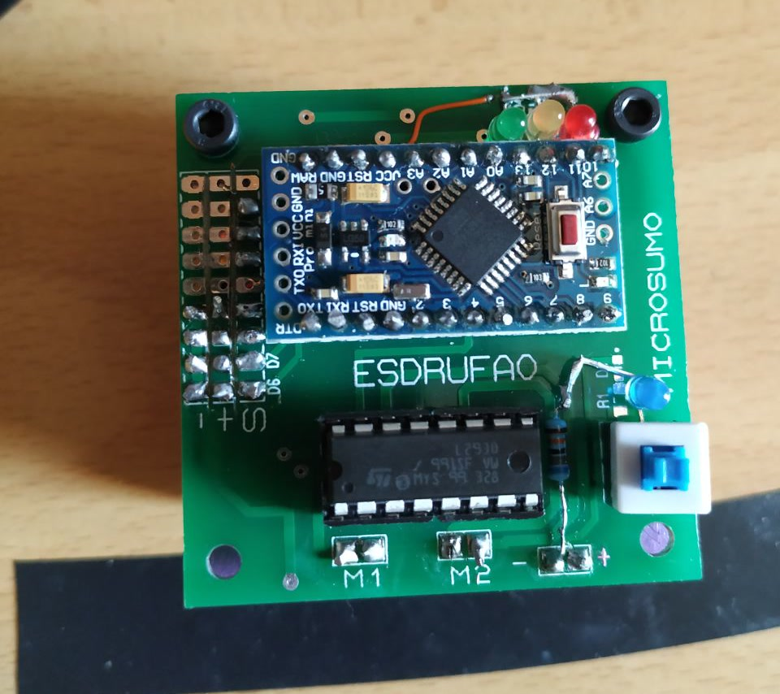
</p>

## ¿Cuál es mi propósito?

<table width="100%">
  <tr>
    <td width="50%" align="right" valign="middle">
      <table align="right" width="1">
        <tr>
          <td align="left">
            ¿Cuál es mi propósito?<br>
            -Pasar la caja.<br>
            Oh, dios mío...<br>
            -Ya, bienvenido al club XD
          </td>
        </tr>
      </table>
    </td>
    <td width="50%" align="left" valign="middle">
      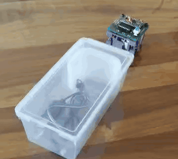
    </td>
  </tr>
</table>

## Sensores

Herculito lleva 6 sensores TCRT5000 iguales, repartidos en dos grupos:

- 3 de suelo, para leer el borde del dohyo.
- 3 de enemigo, para localizar al rival.

Cada sensor lleva su resistencia soldada en el aire. Detalle en
[docs/03-sensores.md](docs/03-sensores.md).

<p align="center">
  
</p>

## Tracción y ruedas

La tracción son dos servos modificados: se corta el potenciómetro y la
controladora y queda solo el motor con su reductora, que va conectado
directamente al L293D.

La tracción con dos servos fue idea de Esdrufao.

La carcasa se corta y lima, y las piezas van pegadas en L para entrar en el
tamaño del microsumo (50 mm).

Lleva ruedas impresas en 3D pensadas para llevar una junta tórica y anclarse al
eje del servo.

<p align="center">
  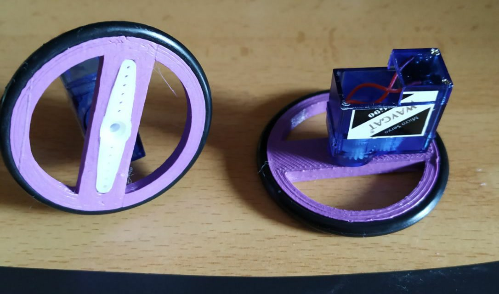
</p>

## Ñapas

Los 4 LEDs van montados through-hole cuando el diseño pide SMD:

<p align="center">
  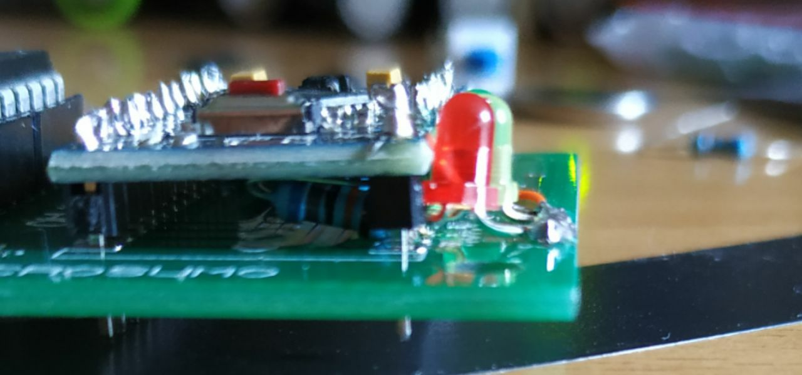
</p>

## Cómo funciona

Herculito funciona en dos modos: microsumo (combate en el dohyo) y siguelineas
(seguir una línea negra).

## Modo microsumo

En combate, los 3 sensores de suelo leen el borde para no salirse del dohyo y
los 3 de enemigo localizan al rival. Con esas lecturas Herculito avanza, gira y
empuja al contrario fuera de la superficie.

<p align="center">
  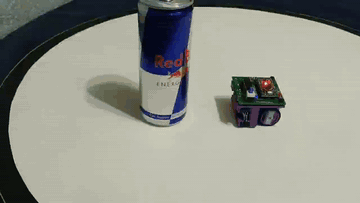
  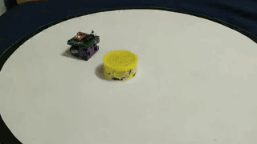
</p>

## Modo siguelineas

Sobre una mesa con una línea negra, el robot sigue el trazado con los sensores
de suelo y corrige la dirección a izquierda o derecha para no perderla.

<p align="center">
  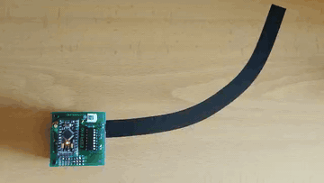
</p>

## Software

- Microsumo: en busca y captura, por ahora no se ha recuperado.
- Siguelineas: [`source_code/siguelineas/HerculitoSiguelineas.ino`](source_code/siguelineas/HerculitoSiguelineas.ino), sigue la línea con los tres sensores de suelo.

Detalle en [docs/04-software.md](docs/04-software.md).

## Documentación

- [Hardware y pinout](docs/01-hardware.md), componentes, alimentación y conexionado
- [PCB](docs/02-pcb.md), la placa de Esdrufao y su esquema
- [Sensores](docs/03-sensores.md), los 6 TCRT5000 y su montaje
- [Software](docs/04-software.md), el sketch de siguelineas

Documentación completa en [docs/index.md](docs/index.md).

## Estructura del repositorio

```
Herculito/
├── pcb_files/     # Esquemático de la placa (microsumo, Esdrufao)
├── source_code/   # Siguelineas
├── images/        # Fotos, esquemas y GIFs
├── 3d_model/      # Chasis (Mario V.C.) y ruedas
└── docs/          # Documentación
```

## Galería

<p align="center">
  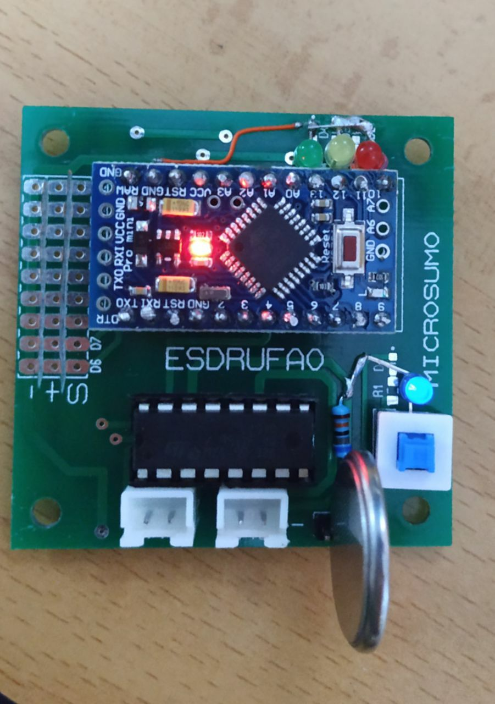
  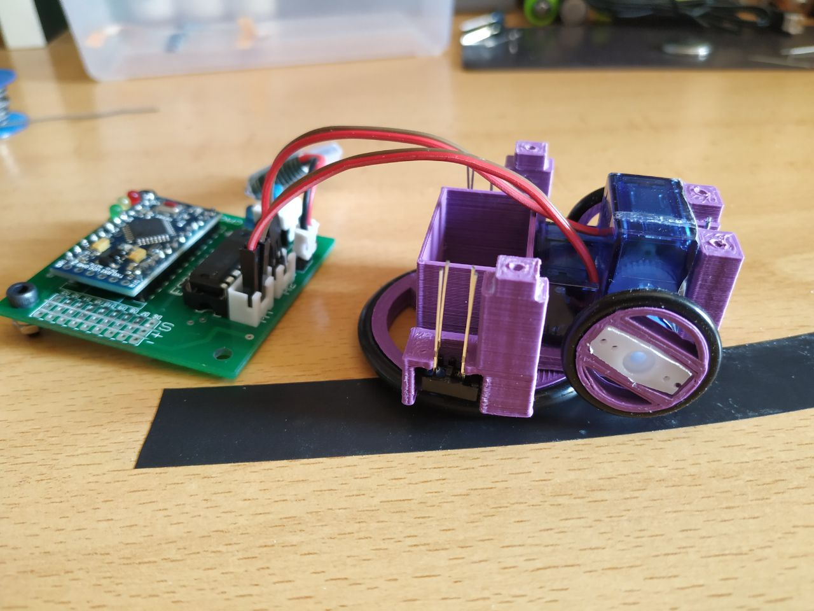
  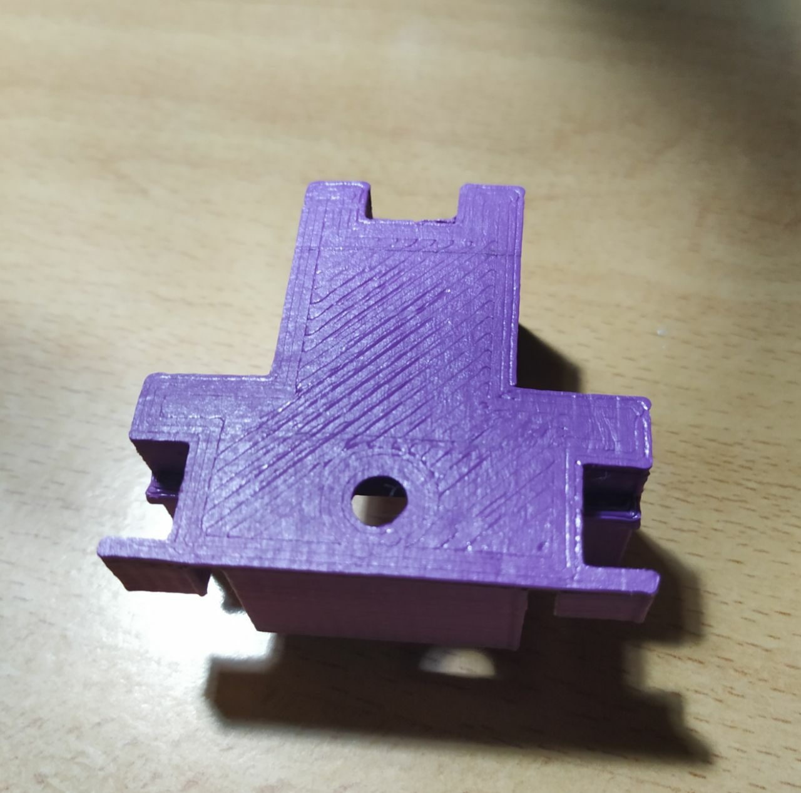
  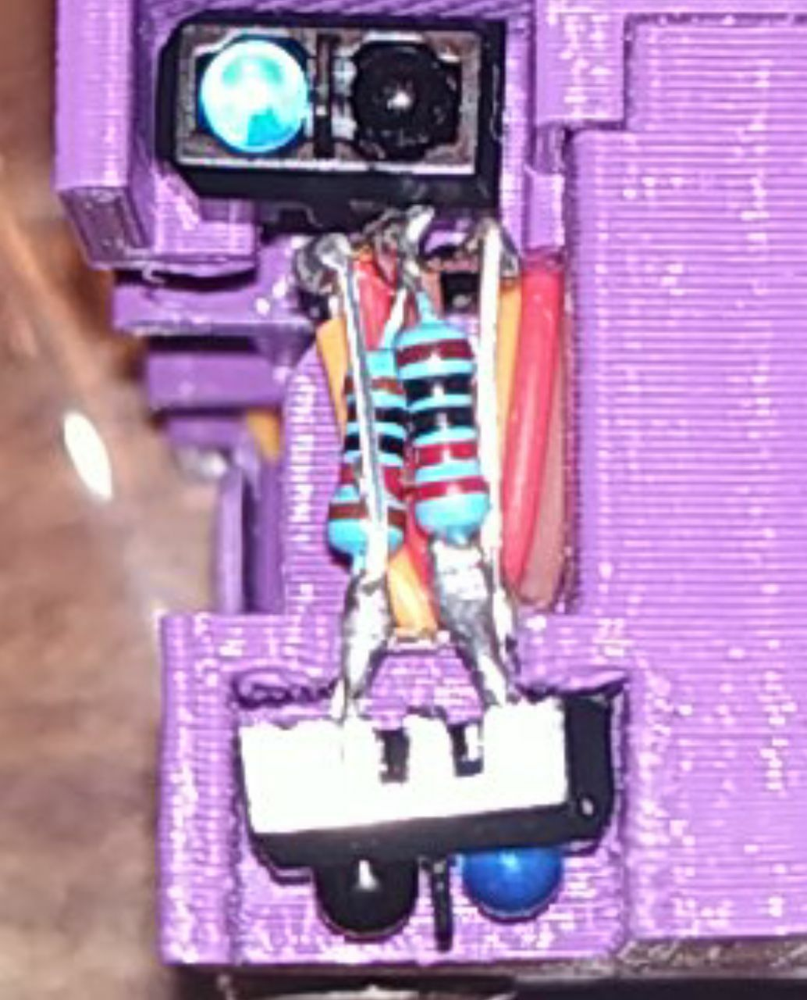
</p>

## Créditos y licencia

- Chasis: diseño de Mario V.C.
- Placa: donación de Esdrufao.
- Documentación: licencia GPL-3.0 (ver [LICENSE](LICENSE)).