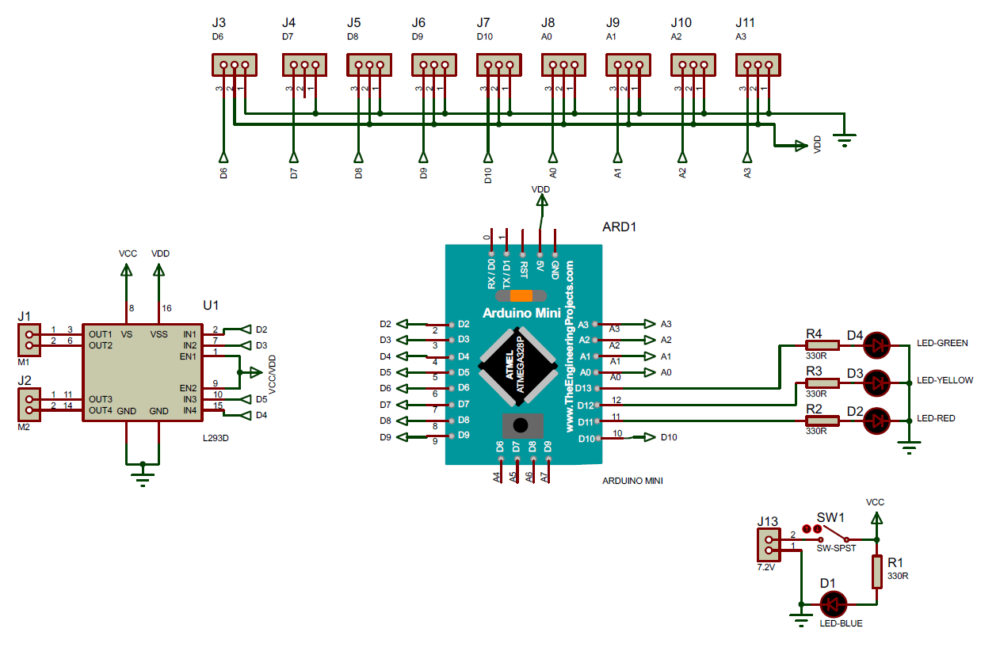

[← Volver al índice](index.md)

# 02, PCB

La placa de Herculito es un diseño de microsumo de Esdrufao (2019), dibujado en
Proteus 8 (ARES), que él mismo donó para el montaje.

## Esquemático

| Archivo | Contenido |
|---|---|
| `pcb_files/microsumo_pcb.pdf` | Esquemático MICROSUMO (hoja única, 14/05/2019) |

### Bloques del esquemático

- `ARD1`, Arduino Mini (ATmega328P).
- `U1`, L293D (driver de motores).
- `D1`–`D4`, 4 LEDs de estado (azul, verde, amarillo y rojo) con `R1`–`R4`
  de 330 Ω.
- `J3`–`J11`, pads de 3 pines para los sensores, mapeados a
  `D6`, `D7`, `D8`, `D9`, `D10`, `A0`, `A1`, `A2`, `A3`.
- `J1` / `J2`, pads de motor `M1` / `M2`.
- `J13`, entrada de alimentación `7.2V`, con el interruptor `SW1`.

### Pines de los sensores

| Pad | `J3` | `J4` | `J5` | `J6` | `J7` | `J8` | `J9` | `J10` | `J11` |
|---|---|---|---|---|---|---|---|---|---|---|
| Pin | `D6` | `D7` | `D8` | `D9` | `D10` | `A0` | `A1` | `A2` | `A3` |

## Fabricación

El montaje se conserva como esquemático. Sensores y motores van soldados
directamente a la placa, cada sensor con su resistencia en el aire.

---

[← 01 - Hardware y pinout](01-hardware.md)  |  [03 - Sensores →](03-sensores.md)