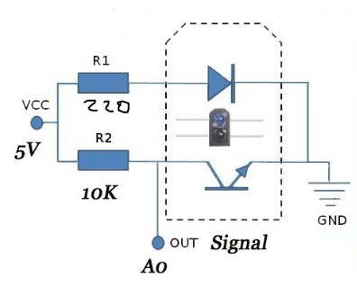
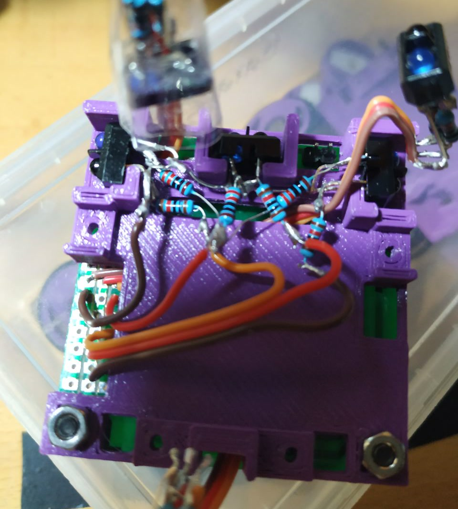

[← Volver al índice](index.md)

# 03, Sensores

Herculito monta 6 sensores TCRT5000 iguales, repartidos en dos grupos de tres.

## Montaje

- 3 de suelo, para detectar el borde del dohyo.
- 3 de enemigo, para localizar al rival.

  
  

## Pines

Los seis van a los pines `D6`–`D10` y `A0`–`A3` (tabla de mapeo en
[PCB](02-pcb.md)).

---

[← 02 - PCB](02-pcb.md)  |  [04 - Software →](04-software.md)